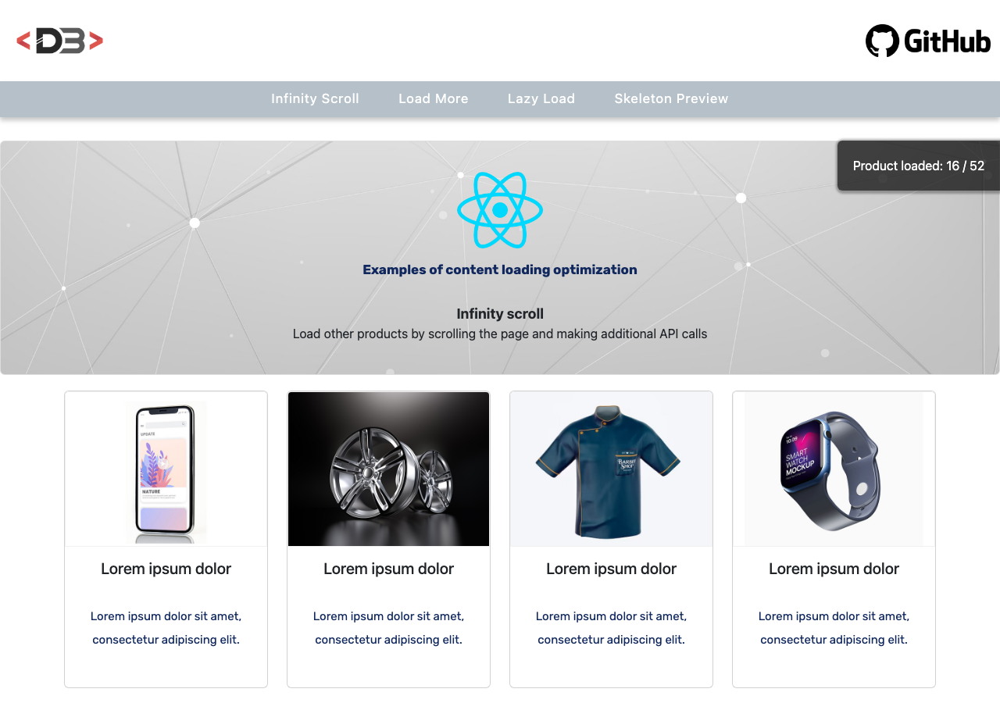

# React Loading Optimization

A React demo that compares four techniques for loading content from a REST API efficiently:
infinite scrolling, a "load more" button, lazy loading and skeleton placeholders.

**Live demo:** <https://loading-optimization.davidebalice.dev/>



## Features

- **Infinite scroll** – loads the next page of products when the user scrolls near the bottom of the page
- **Load more** – loads the next page of products when the user clicks a button
- **Lazy load** – loads products asynchronously in four batches, one every two seconds, using `React.lazy` and `Suspense`
- **Skeleton preview** – shows placeholder cards while the products are being loaded
- Counter of the products loaded so far
- Responsive product grid

## Tech stack

- [React 18](https://react.dev/)
- [Vite](https://vite.dev/)
- [React Bootstrap](https://react-bootstrap.github.io/) / [Bootstrap 5](https://getbootstrap.com/)
- [Axios](https://axios-http.com/)
- CSS Modules

## Getting started

### Requirements

- Node.js 20 or later
- npm
- A products API exposing `GET /api/v1/products?page=<n>&limit=<n>`

### Installation

```bash
git clone https://github.com/davidebalice/react-loading-optimization.git
cd react-loading-optimization
npm install
```

### Configuration

The API URL is read from Vite environment variables.
`.env.production` contains the values used for the production build; for local development
copy `.env.example` to `.env` and adjust it:

```bash
cp .env.example .env
```

| Variable            | Description                    |
| ------------------- | ------------------------------ |
| `VITE_API_BASE_URL` | Base URL of the products API   |

### Available scripts

| Command           | Description                              |
| ----------------- | ---------------------------------------- |
| `npm run dev`     | Start the development server             |
| `npm run build`   | Create a production build in `dist/`     |
| `npm run preview` | Preview the production build locally     |

## Project structure

```
src/
├── common/        # Header, menu, hero, footer and layout wrapper
├── components/    # Infinite scroll, load more, lazy load and skeleton demos
├── assets/        # Images
└── main.jsx       # Application entry point
```

## Author

**Davide Balice** – [davidebalice.dev](https://www.davidebalice.dev)
